<p align="center">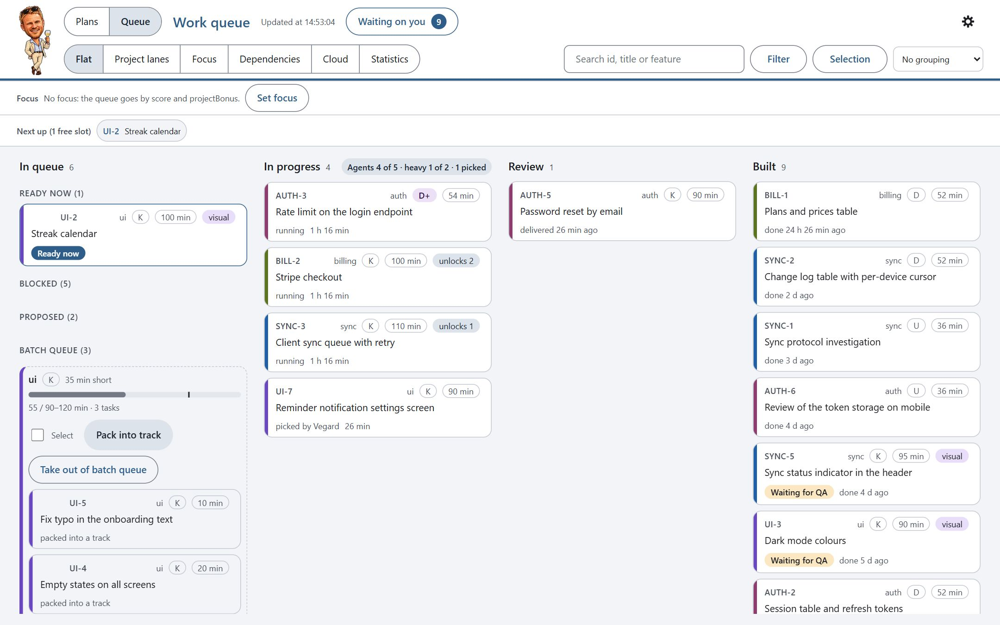</p>
<p align="center"><sub>The board with a made-up demo project ("Pebble", a habit tracker). More screenshots in <a href="#a-tour-of-the-board">A tour of the board</a>.</sub></p>

# claude-code-queue

A Claude Code plugin that does two things:

1. **Keeps track of your plans and tasks.** Ideas and plans go into a plan register. Work that is ready goes into a
   work queue. Both live on disk, so nothing is lost when a chat ends or gets compacted, and a local board shows it
   all.
2. **Lets Claude Code work through the queue continuously without wasting tokens.** One chat acts as the
   orchestrator. It hands each task to a fresh agent with a small, self-contained mission, in its own git worktree.
   Contexts stay small, so each turn stays cheap.

By Vegard Cowie Jørgensen.

## Why I built it

I wanted a project that keeps moving without me sitting at it. With the queue, Claude Code runs a large project on
its own for long stretches, often overnight or for days. It picks the next task, starts track agents, reviews and
merges what they deliver, and starts the next tasks. When a task needs my decision, the queue does not stop: it parks
that task and carries on with everything else that can be done. The decisions wait for me on the board, or the
orchestrator lists them in the chat, each with context and a recommendation.

Most of the time I work from my phone. Remote Control connects me to the orchestrator chat in Claude Code, so I only
deal with a single chat. The work itself happens in fresh, small contexts for each task. The orchestrator keeps its
state in the queue and in a handover note, and the chat is compacted automatically at 300k tokens of context, so it
can keep going for days. From the phone I ask what is next, what is blocked or what a plan contains, and I answer the
open questions. The tasks that waited on them then move on.

On the desktop I use the board to keep track of the project. I go through the open questions, manage the
dependencies between tasks, and choose the focus. With focus, I pick which areas of the project to work on now. The
queue finishes those before it moves on to the next feature or step I want. The queue also helps Claude Code keep
order: it keeps track of the plans, the tasks, what depends on what and what is running right now, so nothing gets
lost between sessions.

Before this, I worked in long chats, and the token bill grew much faster than the work did. Splitting the work into
right-sized tasks, each in a fresh small context, cut my usage a lot. On a Claude Max (20x) plan, the queue now keeps
running for about five days of a week before the weekly limit runs out. That is one project and one developer; see
[What it costs in tokens](#what-it-costs-in-tokens) for what was measured and what was not.

## The concept in one minute

- **Plan register:** a list of ideas, plans and investigations, each with a priority and a maturity (idea,
  investigated, planned, ready, then in the queue, built and verified). It points to your documents instead of copying them.
- **Work queue:** concrete tasks. Each has a class (risk level), an estimate, a value, dependencies, the files it
  owns, and any open questions for you. The queue picks the next task by value per minute.
- **Orchestrator:** one Claude Code chat that runs the loop. It starts tasks, reviews results, merges them and asks
  you what only a human can decide. It does not write the code itself.
- **Tracks:** each task runs as a subagent in its own git worktree, on its own branch. It gets a short mission file,
  does the work, runs your checks, commits on its branch and answers with one line. The long report goes to a file,
  not into the orchestrator's context.
- **Board:** a local web page (kanban, plans, dependencies, cost, and "Waiting on you").

Task classes decide size and review:

| Class | Meaning | Size of one task | Review |
|---|---|---|---|
| K | Ordinary code | 90 to 120 min of work | none |
| U | Investigation | about 60 min | the challenger (a helper agent) |
| D | Database or contract change | about 40 min | one reviewer agent |
| D+ | High-risk database or security | 25 to 30 min | two reviewer agents |

On top of that come **helper agents**: optional reviewers you switch on and off (`cq helpers`, or the Helper agents
tab in the board's settings). By default the challenger runs for U and `bug` tasks and the design reviewer for
`visual` tasks; the tests, gap and docs reviewers are off. The board shows what each one costs in minutes, tokens and
dollars, and how many findings it gives. See [orchestration](plugin/docs/orchestration.md#helper-agents).
You can add your own agent file as a **custom helper** (`cq helpers add <file.md>`, or "add this as a helper
agent"): it is copied, scanned, read by Claude and approved by you against its hash before it can be switched on,
and it turns off again if the file changes. See
[custom helper agents](plugin/docs/orchestration.md#custom-helper-agents).

## First run in 5 minutes

1. **Install** (in Claude Code): `/plugin marketplace add vegardjorg/claude-code-queue`, then
   `/plugin install cq@claude-code-queue`.
2. **Set up the project:** open your project and run `/cq:setup` (it asks first), or do it by hand with
   `cq setup --settings` and `cq init` (the config, the docs, the recommended settings and the empty queue).
3. **Add a task:** say "add to the queue: <what you want done>", or write a JSON file and run `cq add --file task.json`.
4. **Start the queue:** `/cq:queue`. It shows the state and asks before it starts any agent.
5. **Open the board:** `/cq:board` gives you a local link. Answer questions under "Waiting on you"; an empty queue
   shows the same three steps.

Cloud sessions and follow-up entries are off by default, and so are the Legal, Launch and Documents surfaces in
Plans. Turn them on with `features` in `queue.config.json` (see [configuration](plugin/docs/queue.md#configuration)).

## A tour of the board

**Start it:** in Claude Code, run `/cq:board` (or say "start the board"). Claude starts it in the background and
gives you a link like `http://127.0.0.1:2000/#key=…`. It runs while that Claude Code session runs. To keep it
running on its own, start it from your own terminal in the project folder:
`node "<plugin folder>/scripts/orchestrator/cq.mjs" board` (`/cq:board` tells you the exact path). The plain `cq`
command only exists inside Claude Code.

The board only listens on 127.0.0.1, and the key in the link changes on every start. It follows your system's light or dark mode; the gear lets you pick one. The screenshots use a made-up demo project.

### The queue

The main view (top of this page) is a kanban: **In queue** (ready now, blocked, proposed by agents, and the batch
queue where small tasks wait to be packed into one track), **In progress** and **Review**. Each card shows the id,
domain, class (K, D, D+ or U), estimate and how many tasks it unlocks. **Next up** shows what the orchestrator starts
in the next free slot. Other views: **Project lanes** (one row per project), **Focus** (only what you have chosen to
push), **Cloud** and **Statistics**.

### Task detail

<p align="center">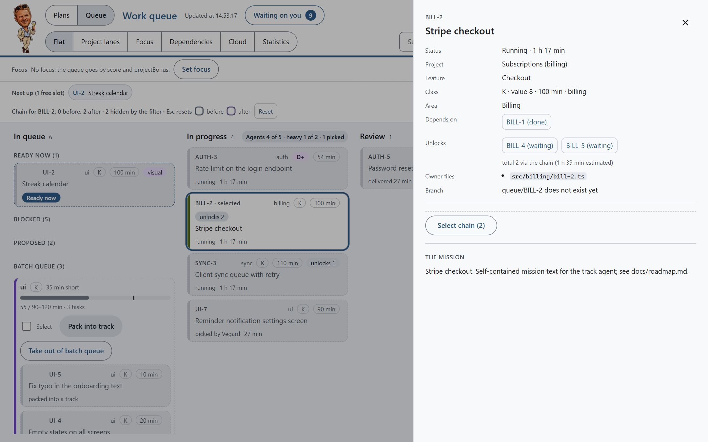</p>

Click a card to open it: the mission, the files it owns, what it waits on, cost and time so far, and the actions
for its status. The chain of tasks before and after it is highlighted on the board.

- **Waiting:** *To the top of the queue*, *Pick* (a person takes it), *Put on hold* / *Take off hold*, *Add to
  batch queue* / *Take out of batch queue*, *Edit* (value 1-10, content minutes and class) and *Cancel task* (you
  confirm first, with an optional reason saved as a remark). Cloud-suitable tasks also get *Copy cloud package* and
  *Started in cloud*.
- **Proposed** (added by an agent): *Edit*, *Decline* (cancels the proposal, with an optional reason), on hold and
  batch queue. Approve proposals in **Waiting on you**, where each one also has *Decline*.
- **Running and review:** nothing that stops the work, since an agent may be working on it. The panel shows the
  command to cancel it from the CLI (`cq set <id> cancelled --remark "<why>"`).
- **Picked:** *Release*. **In a cloud session:** *Completed in cloud* and *Cancel cloud*. **Built with a visual
  check:** *QA ok* and *QA deviation*.

Edit, cancel, decline and the bulk actions show **Undo** for 30 seconds afterwards (and *Undo last* in the gear).
Change the priority by dragging cards (or with the keyboard), or select several cards and move them together.

### Waiting on you

<p align="center">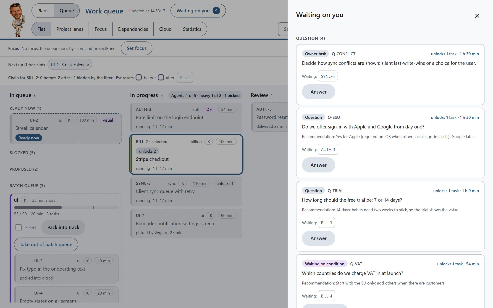</p>

Everything only you can decide lands here: questions from agents (with their recommendation), owner tasks and
conditions. Each shows which tasks it blocks. Answer on the board, and the orchestrator picks up the answer and
unblocks the tasks.

### Dependencies

<p align="center">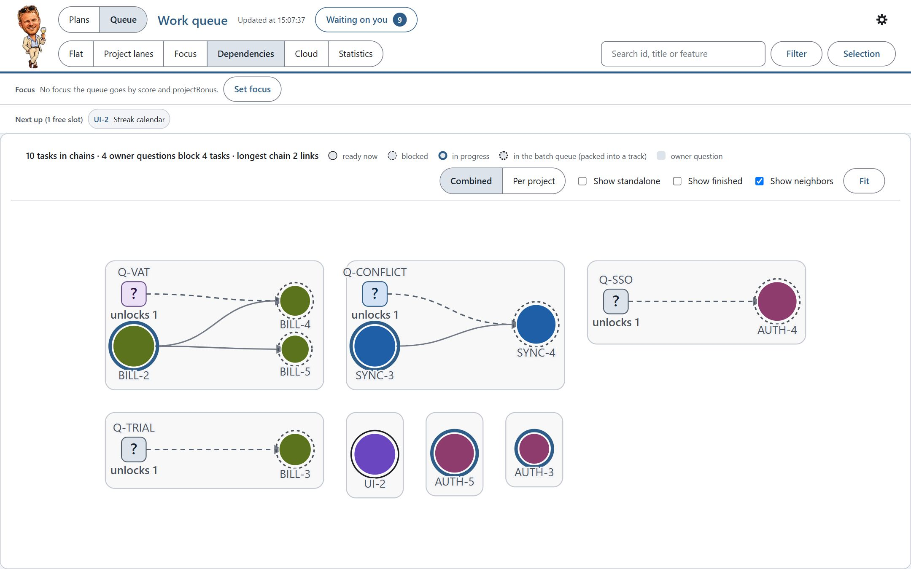</p>

The chains as a graph: circles are tasks (solid ring = in progress, dashed = blocked), squares are open questions.
It shows at a glance which single answer unlocks the most work.

### Statistics and cost

<p align="center">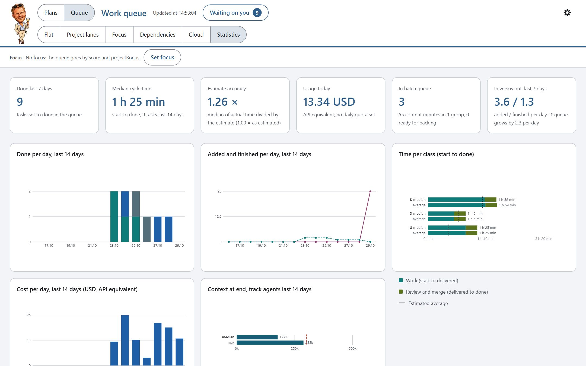</p>

Done per day, cycle time, how good the estimates are, cost per day (API-equivalent), time per class, and how large
the agents' contexts got. This is where you see whether the queue earns its keep.

### Plans

<p align="center">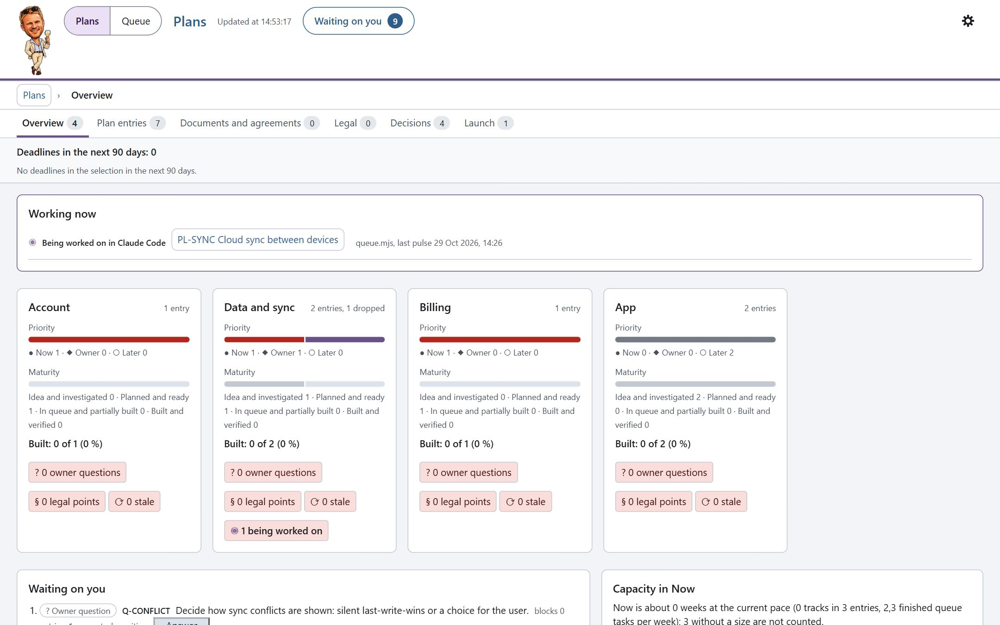</p>

The **Plans** room is the plan register: one card per area with priority (now, owner, later) and maturity (from
idea to built and verified), open questions, legal points and stale plans, plus what is being worked on right now.

<p align="center">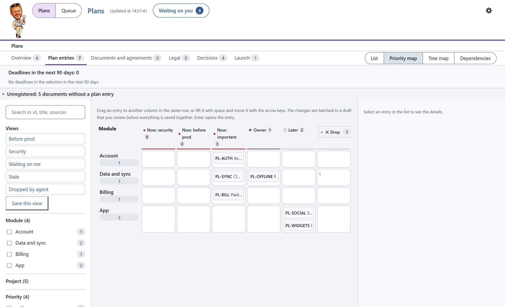</p>

The **priority map** puts every plan entry in a grid of area by priority. Drag an entry to another column (or use
the keyboard); changes are collected in a draft you review before anything is saved. **Tree map** and
**Dependencies** show the same entries by size and by order.

### Dark mode

<p align="center">
  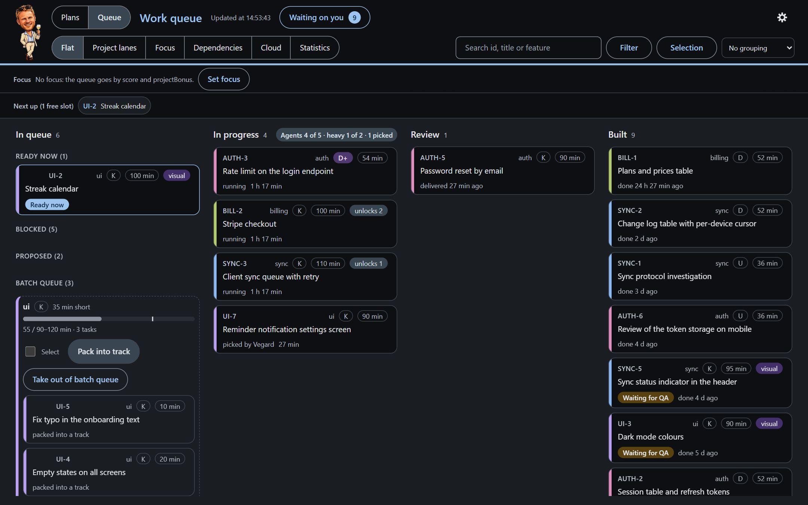
  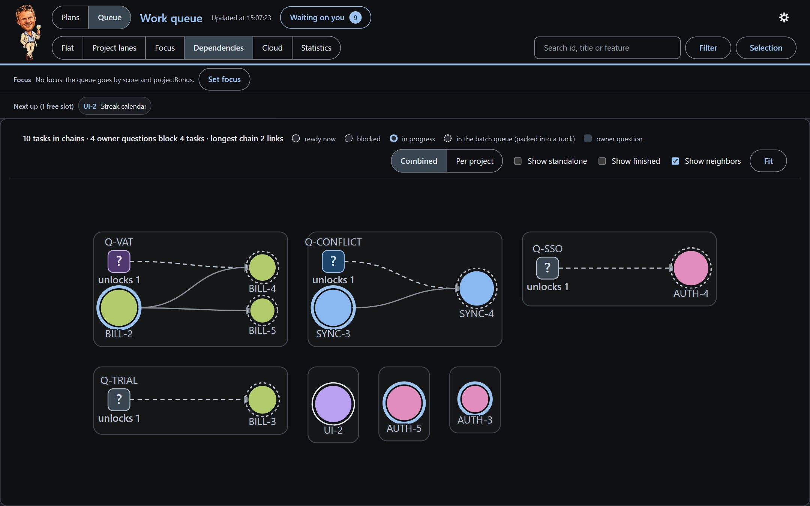
</p>
<p align="center">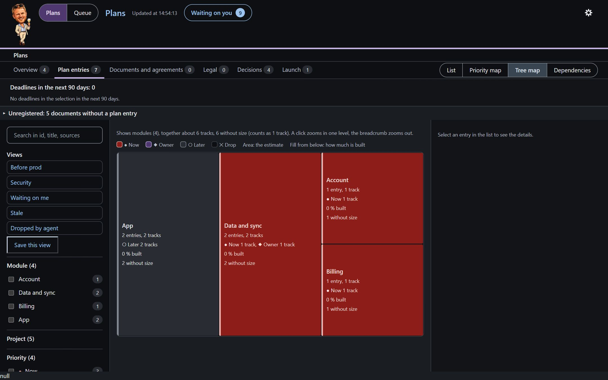</p>

### Settings

<p align="center">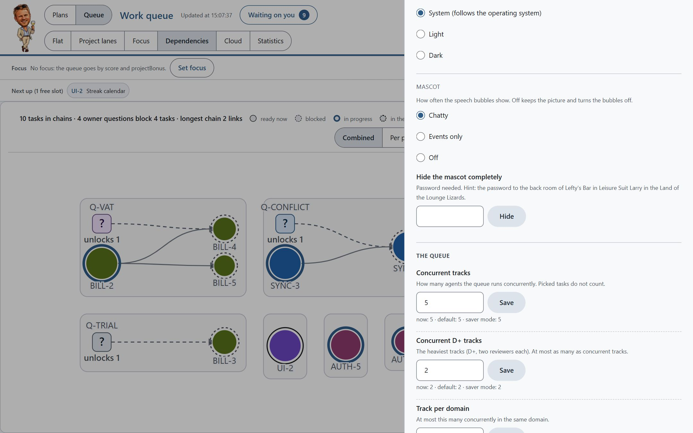</p>

The gear holds the help, the theme, the mascot and the queue's limits (how many tracks run at once, how many heavy
D+ tracks, tracks per domain, daily budget, night pause, automatic compaction). Each setting shows its current
value, the default and, for the track limits, the recommended ceiling that keeps the weekly quota from running out
early.

## Install

As a Claude Code plugin (recommended). In Claude Code:

```
/plugin marketplace add vegardjorg/claude-code-queue
/plugin install cq@claude-code-queue
```

Then open your own project and run `/cq:setup`. It:
- creates `queue.config.json`, `docs/queue/` and `CLAUDE.queue.md`, and adds two lines to `.gitignore`;
- asks before it changes `CLAUDE.md` or `.claude/settings.json`;
- fills in your checks (type check, lint, tests) and your project's areas with you;
- creates the empty queue and runs a short smoke test;
- offers to turn your existing notes, TODOs and issues into plan entries and tasks.

The plugin's hooks do nothing in projects without a `queue.config.json`, so it is safe to keep installed.

Update with `/plugin update`; the board shows a banner when a new version is out, with the steps (turn the check off
with `"board": { "updateCheck": false }`, see [board](plugin/docs/board.md#update-banner)). To try it without installing: `claude --plugin-dir <path-to-this-repo>/plugin`.

Without the plugin system you can copy everything into the project instead ("vendored" install): open Claude Code in
your project and say *Install claude-code-queue from `<path-to-this-repo>`; follow its INSTALL.md*. See
[INSTALL.md](INSTALL.md).

Requirements: Node.js 20 or newer, git and Claude Code. No npm packages are needed at run time.

## Daily use

You do not need the commands. Talk to Claude Code as usual: "add this to the queue", "what's next", "start the
queue", "show the board". The skills pick that up, in any language, and when you have planned a task together,
Claude offers to queue it. The slash commands below are the explicit way to do the same.

1. **Add work.** Say "add it to the queue" (or `/cq:add-to-queue` followed by what you want done), or `/cq:plans`
   to work on a plan. Tasks you add can start at once; tasks that agents propose wait for your approval.
2. **Start the loop.** Open a chat and run `/cq:queue`. It reports the state and asks before it starts. Then it fills
   the free slots with track agents, reviews and merges what they deliver, and starts the next tasks, until the queue
   is empty, the daily budget is used, or everything left waits on you.
3. **Check the board.** Run `/cq:board` (or ask Claude to "start the board"). It starts the board in the
   background and gives you a local link. Answer open questions there; the orchestrator picks the answers up.
4. **Push when you are ready.** Merges stay local. Nothing is pushed until you say "push", and then in one batch.

Other skills: `/cq:pick` to take one task and do it yourself in the current chat, `/cq:parallel-wave` for the full
orchestration rules, and `/cq:start` to open a session cheaply before you paste a task (it only answers "ready";
`cq show` gives the queue state).

## How it works

```
 you ──> orchestrator chat (/cq:queue) ──> cq fill ──> track agents in worktrees (queue/<ID> branches)
                 ^                                            │
                 │                                   RESULT line + report.md
                 │                                            v
          questions for you <── review (reviewer agents) <── cq receive
                 │
                 └──> cq merge ──> base branch ──> batch push when you say "push"
```

1. Each task gets a mission file: the shared rules from `docs/queue/mission-template.md`, filtered for its class,
   plus the task's own description.
2. The track works in its own worktree and branch, runs the checks (`gates` in `queue.config.json`), and ends with
   one machine-readable `RESULT` line. A fail-fast precheck (`cq gates --precheck`: syntax, type check, lint and the
   related tests, only on the changed files, stopping at the first red one) runs before the full gate, so a red
   error shows up in minutes.
3. The orchestrator builds a review package, runs the reviewer agents the class needs, and starts a fresh agent for
   any fix round.
4. When the review is clean, it merges the branch, runs the quick checks and fills the free slot.

Hooks support the loop: they warn the orchestrator and the tracks when their context gets large, block force pushes,
pushes of branches other than the base branch and migration pushes to the wrong environment, put the queue state back into the chat after compaction, and log the time and
tokens of every subagent.

**Hardening against prompt injection.** Tracks treat what they read as data, not instructions. The merge stops
(exit 4) when a branch changes hooks, settings, agents, the orchestrator scripts or the queue config without owning
them (`protectedPaths` in `queue.config.json`; `cq merge <ID> --allow-guard` overrides), and tracks cannot run `curl`,
`wget`, `iwr` or a pipe into a shell ([orchestration](plugin/docs/orchestration.md#hardening-against-prompt-injection)).

**Context limit in every chat.** In a project with the queue, every chat gets a notice at 250k tokens of context,
and at 400k the message is stopped so a long chat does not keep paying for its whole history. Compact the chat
(`/compact`), or start the message with `continue:` to send it anyway. The limits can be changed with environment
variables ([orchestration](plugin/docs/orchestration.md)).

**Status line and handover.** `cq setup --settings` adds a status line with context, cost, quota and running
tracks (run it again after a plugin update). The orchestrator keeps a handover note; after compaction it reads only
the "Now" part, and a new orchestrator chat can adopt tracks that are still running (`cq deliveries`, `cq resume`).

**Follow-ups and QA evidence.** `cq follow add` tracks something over a period (board page `/follow`; off by
default, turn it on with `"features": { "follow": true }`), and tracks write an `EVIDENCE` line that `cq qa auto --run` uses to close QA entries that are green.

**Changes per version:** [CHANGELOG](CHANGELOG.md).

**Local time.** The night pause, the daily budget and the statistics per day use the machine's time zone. Set the
`TZ` environment variable to use another.

More detail: [orchestration](plugin/docs/orchestration.md), [queue reference](plugin/docs/queue.md),
[plan register](plugin/docs/plan-register.md), [board](plugin/docs/board.md),
[mission template](plugin/docs/mission-template.md).

## Cloud sessions

Tracks can also run in Claude Code's cloud sessions on claude.ai instead of on your machine. I built this to use the
$250 in cloud credits I got from Anthropic, but it works just as well with pay-as-you-go: the cloud gives you more
parallel tracks without more load on your own computer. Cloud is off by default: turn it on with
`"features": { "cloud": true }` in `queue.config.json`.

- **What can go to the cloud:** ordinary code tasks (K and U) without migrations or database changes. The queue
  decides which tasks fit, and the board's **Cloud** tab lists them, grouped into bundles of up to 4 tasks per session.
- **Start:** copy the package from the Cloud tab into a cloud session, or run
  `node "<plugin folder>/scripts/orchestrator/cq.mjs" cloud-start <id> [<id> …]` in your own terminal from the
  project folder (ask Claude for the full path). It opens `claude --cloud`, which draws from the cloud session credits.
  At most 3 cloud sessions run at once.
- **Back home:** when the cloud session reports it is done, the orchestrator fetches the branch and reviews and merges
  it like any other track (`cq cloud done <id>`).
- **Push first:** a cloud session starts from your base branch on GitHub, so it only sees what is pushed.
- **Keep track of the credits:** `cq capacity --cloud-credit <usd left>` records the cloud pot separately from your
  plan's weekly quota.

## Key commands

All scripts share one entry point, `cq`. With the plugin, `cq` is on the PATH of Claude Code's Bash tool. In a
vendored install, write `node scripts/orchestrator/cq.mjs` instead of `cq` (the installer already does this in the
files it copies).

```
cq init                      # once per project
cq show                      # short queue view
cq add --file task.json      # add tasks
cq fill --scratchpad <dir>   # start what the limits allow
cq receive <ID>              # receive a finished track
cq merge <ID>                # merge it
cq cost                      # measured cost per class
cq helpers                   # helper agents: on/off and what they cost
cq helpers add <file.md>     # a custom helper: copied, scanned, off until approved
cq plan show                 # plan register
cq board                     # the board: prints a local link with a key
cq follow                    # follow-up entries
cq handover now              # the "Now" part of the handover note
cq help                      # all commands
```

## What it costs in tokens

Every turn in Claude Code sends the whole conversation again (most of it from the prompt cache, which is cheaper but
not free). So a turn costs more the larger the context is, and a session costs roughly **number of turns times
context size**. The system is built around that fact: many short contexts instead of one long one.

**Read these numbers with care.** They come from one project (mine), one developer and a few months of use, about
1,200 measured tasks. They are not a benchmark, and there is no controlled comparison with other ways of working.
- The cost per task is **measured**: the subagent logs record the tokens, and the dollar amounts are what those
  tokens would cost at API prices. On a subscription you pay a flat fee; the amounts only show relative use.
- The comparison with "one long chat" and "many small chats" below is **my estimate from experience**, not a
  measurement.
- Your numbers depend on your codebase, your tasks, your checks and the model, and will differ.

**Measured: median cost per finished task, including its review.**

| Class | Median USD (API-equivalent) | Average USD | Median tokens (mostly cache reads) | Median turns |
|---|---|---|---|---|
| K (code) | about 2.5 | about 3.1 | about 10M | about 60 |
| D (database) | about 5.1 | about 5.7 | about 25M | about 105 |
| D+ (high-risk) | about 7.5 | about 8.8 | about 36M | about 137 |
| U (investigation) | about 1.8 | about 2.1 | about 6.5M | about 42 |

The orchestrator added about 18 turns and about 0.75 USD per task. Its target is now 10 turns or fewer per task.

**Measured: where tokens were wasted, and what the plugin does about it.**
- Turns taken while a track's context was above about 300k tokens were about 61% of track cost. So a track stops at
  about 300k: it commits, writes a handover note, and a fresh agent continues. A track may compact once; at the second
  compaction it delivers PARTIAL. A SubagentStop gate (`hook-track-end.mjs`) sends a track back once if it stops with
  neither a commit nor a RESULT line.
- The orchestrator's handover note grew to thousands of lines that every takeover read in full. So it has a short
  "Now" part and a dated log; `cq handover archive` moves old log entries to a monthly archive, and only "Now" is read
  after compaction and at takeover. A status line (`cq setup --settings`) shows context, cost, quota and running
  tracks while you work.
- Prompt cache expiry while waiting was about 23% of all usage. So there are no sleep or polling loops, and
  subagents use a 1-hour cache.
- Fix rounds sent to an agent that already held 400k to 900k tokens of context were 35 to 38% of track cost. So fix
  rounds always start a new agent with a short mission.
- Fixed overhead per track (setup, reading, checks, report) was about 60% of a small K task and 30 to 40% of a D or
  D+ task. So task sizes are set per class, and small tasks are bundled.

**Estimated, not measured: the alternatives.**
- *One long chat.* Each new message pays for the whole history again. In my project, a message at over 500k
  context cost close to three times as much as the same message at 100k to 200k, and quality dropped as the context
  filled. I expect this to cost several times more per task than the queue, more the longer the session runs.
- *Many small chats by hand.* The context stays small, but every chat pays the start-up cost again (reading the
  project, finding files, running checks), and you do the coordination yourself: no shared queue, no file ownership,
  no review step, and merge conflicts when chats overlap.

Run `cq cost` in your own project to see where your tokens go.

## The talking mascot

The mascot in the board's top-left corner comments in a speech bubble on the queue's numbers and events (a merge,
an empty queue, a new question for you). To quiet it:
- per browser: the gear menu, **Mascot**: Chatty, Events only or Off (Off keeps the picture, without bubbles);
- for everyone: `"board": { "mascot": "off" }` in `queue.config.json`, or `cq board --mascot off`;
- to remove the picture too, the gear has a password field. The hint is in the gear. **Show the mascot again**
  brings it back.

Your own phrases go in the gitignored `<dataFolder>/mascot-phrases.json`. See
[docs/board.md](plugin/docs/board.md#the-mascot).

## Not included

This is the queue system only. My own project has more around it, which was too project-specific to include. You
will want your own versions of these:
- **CI/CD.** No GitHub workflows are included, and the checks the tracks run are only what you put in
  `queue.config.json` (`gates.quick`, `gates.full`). Build your own pipeline, so code is tested behind gates before
  it reaches staging or production: at a minimum type check, lint and tests on every push, and a separate, deliberate
  step to promote staging to production. Agents write a lot of code quickly, so this matters more, not less.
- **Screenshots and visual checks.** Tasks can carry the label `visual` and land on a manual QA list (`cq qa`), but
  nothing takes screenshots. Either write a small script of your own that opens the app in a headless browser and
  saves screenshots, or use an end-to-end test tool such as Playwright, which can click through flows and take
  screenshots at the same time.
- **Project-specific database tooling** (local database pools, probe runners, migration dry runs). Migration
  numbering is optional and set in `queue.config.json`.

## Development

```
npm install
npm test        # vitest; runs the unit tests under plugin/scripts/orchestrator
```

## License

MIT. See [LICENSE](LICENSE). The helper agents `reviewer-design`, `reviewer-tests`, `reviewer-gap` and
`reviewer-docs` are adapted from [testdouble/han](https://github.com/testdouble/han) (MIT, Copyright 2026 Test
Double, Inc.); the license text is in [NOTICE](NOTICE).

## About the logo

The logo is a self-roast of the author in the style of Leisure Suit Larry, one of his first computer games (from the
same era as Commander Keen and Chuck Yeager's flight trainer). It is an original drawing and is not affiliated with
or endorsed by the owners of those games.

Keeping the logo in the top-left corner of the board is a friendly request, not a license condition. You are
welcome to restyle it.

The mascot also talks. It nags you when you work at night, cheers when a branch is merged, comments on the
numbers, and once in a while tells a vibe coding joke. Turn the speech bubbles off under Mascot in the settings.

<p align="center">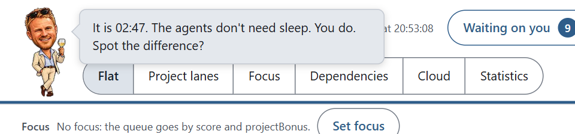</p>

Ken sent me.
